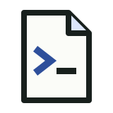
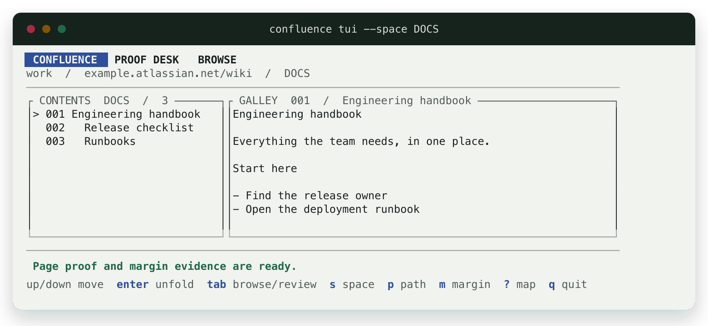

<div align="center">
  <a href="https://github.com/rvben/confluence-cli">
    
  </a>
  <h1>confluence-cli</h1>
  <p><strong>Confluence, readable and scriptable.</strong></p>
  <p>Read, search, browse, automate, and edit Confluence Cloud or Data Center—without leaving the terminal.</p>
  <p>
    <a href="https://github.com/rvben/confluence-cli/actions/workflows/ci.yml"></a>
    <a href="https://codecov.io/gh/rvben/confluence-cli"></a>
    <a href="https://crates.io/crates/confluence-cli"></a>
    <a href="https://pypi.org/project/confluence-cli-rs/"></a>
    <a href="LICENSE"></a>
  </p>
  <p>
    <a href="#install">Install</a> ·
    <a href="#quick-start">Quick start</a> ·
    <a href="#read-and-explore">Read and explore</a> ·
    <a href="#proof-desk-tui">Proof Desk</a> ·
    <a href="#command-surface">Commands</a>
  </p>
</div>

`confluence-cli` makes Confluence directly useful from the shell. Read and browse without creating a local sync directory. Pipe stable JSON into scripts and agents. When content needs to change, work in Markdown and publish through an explicit plan-and-apply boundary.

| Job | Workflow | Result |
| --- | --- | --- |
| Read and browse | `space`, `search`, `page`, `blog`, `tui` | Scannable terminal output and a keyboard-first reader |
| Query and automate | JSON output, `--fields`, `schema` | Stable, token-efficient data for scripts and agents |
| Edit and publish | `pull → edit → plan → apply` | Reviewable Markdown changes with remote-drift protection |

## Install

Choose the package manager that fits your environment. Every distribution installs the `confluence` executable.

With [`uv`](https://docs.astral.sh/uv/) from PyPI:

```bash
uv tool install confluence-cli-rs
```

With Homebrew:

```bash
brew install rvben/tap/confluence-cli
```

With Cargo:

```bash
cargo install confluence-cli
```

With Nix (flakes):

```bash
nix run github:rvben/confluence-cli -- --help
nix profile install github:rvben/confluence-cli
```

The PyPI distribution is named `confluence-cli-rs`; the crate is named `confluence-cli`. Prebuilt macOS and Linux archives for Intel and ARM are available from [GitHub Releases](https://github.com/rvben/confluence-cli/releases).

## Quick start

Connect a profile and check access:

```bash
confluence init
confluence doctor --space SPACEKEY
```

For local-only diagnostics, use `confluence auth status --offline` or
`confluence doctor --offline`. The former `doctor --skip-network` spelling
remains available as a compatibility alias.

Then read, search, or browse immediately—no pull required:

```bash
confluence search 'release notes' --space DOCS
confluence page tree 'DOCS:Handbook'
confluence tui --space DOCS
```

The same commands become structured input when piped:

```bash
confluence search 'release notes' --space DOCS \
  | jq '.items[] | {title, web_url}'
```

<p align="center">
  <a href="https://raw.githubusercontent.com/rvben/confluence-cli/main/assets/proof-desk.png">
    
  </a>
</p>
<p align="center"><sub>Proof Desk in its medium-width Browse layout, rendered from the deterministic test fixture. <a href="https://raw.githubusercontent.com/rvben/confluence-cli/main/assets/proof-desk.png">Open full resolution.</a></sub></p>

When you want to edit, pull a page tree to Markdown and inspect the local plan:

```bash
confluence pull tree 'SPACEKEY:Parent Page' ./docs/parent-page
$EDITOR ./docs/parent-page/parent-page--123/index.md
confluence plan ./docs/parent-page --diff
```

When the plan is correct, apply it:

```bash
confluence apply ./docs/parent-page
```

`plan` reads only the Markdown and sidecar state on disk. `apply` validates the complete local tree and checks every remote version before writing. If Confluence changed after the pull, the apply is refused unless you explicitly choose `--force`.

Before writing a hand-edited storage body, check it offline:

```bash
confluence template expand > body.xml
confluence validate --format storage --body-file body.xml
```

`validate` needs no credentials and makes no API requests. Writes also validate
bodies automatically, catching malformed XML, broken CDATA, and known macro
body mismatches before contacting Confluence. Markdown input, including embedded
storage blocks, goes through the same checks after conversion. See
[storage-format guidance](docs/cli-reference.md#writing-storage-format-bodies)
for the validation limits and error-recovery workflow.

To inspect XML generated from Markdown, run
`confluence convert --body-file page.md --output-file generated.xml`. The saved
artifact remains available if validation fails. Ready-to-use code, expand, and
noformat templates are built into the CLI. Agents can use the bundled
[Confluence skill](skills/confluence/SKILL.md); the
[upgrade and editing workflow](docs/agent-workflow.md) explains installation,
preserving the original body, and updating against its base version.

## Read and explore

The direct commands cover everyday Confluence retrieval without requiring a sync directory:

```bash
confluence space list
confluence search 'on-call rotation' --space OPS
confluence page get 'OPS:Incident handbook' --show-body
confluence page tree 'OPS:Runbooks'
confluence blog list ENG
```

References accept a numeric content ID, a Confluence URL, or `SPACE:Title`. Search accepts plain text by default and full Confluence Query Language with `--cql`.

On a terminal, search results, lists, and page metadata are formatted for scanning. `page get --show-body` includes the canonical storage-format body for agents and transformations; Proof Desk turns that content into a readable page for humans.

When stdout is piped, data commands emit one JSON document:

```bash
confluence search 'release notes' --space DOCS \
  | jq '.items[] | {title, web_url}'
```

For an interactive reading experience, `confluence tui` opens Proof Desk on the first visible space. The `--space` option starts in a specific space, and `o` opens the selected page in Confluence.

## Proof Desk TUI

Proof Desk is a keyboard-first, read-only workspace for reading and browsing Confluence. Add a local path when you also want to review a sync plan:

```bash
confluence tui
confluence tui --space DOCS
confluence tui --space DOCS --path ./docs/handbook
```

Browse mode combines the page hierarchy, a readable Markdown proof, and an outer margin for metadata, labels, attachments, comments, and content properties. Review mode presents the local plan and unified body diffs in the same layout.

The TUI never applies changes and does not contact Confluence to detect drift. `confluence apply` remains the separate, remote-aware write boundary. Passing `--delete-remote` only includes attachment deletions in the local review plan.

| Key | Action |
| --- | --- |
| Arrow keys or `j` / `k` | Move through content |
| `Enter` | Unfold the selected proof |
| `Tab` | Switch between Browse and Review |
| `1`–`4` | Change the margin evidence |
| `s` | Choose a space |
| `p` | Choose a local sync directory |
| `o` | Open the selected page in Confluence |
| `?` | Show the complete keyboard map |

Wide terminals show all three regions. Compact terminals reveal complete proofs and margins on demand. Proof Desk requires interactive stdin and stdout and honors `--no-color`.

## Edit and publish with Markdown

### Pull

Export one page, a page tree, or an entire space:

```bash
confluence pull page 'DOCS:Getting Started' ./docs/getting-started
confluence pull tree 'DOCS:Handbook' ./docs/handbook
confluence pull tree 'DOCS:Handbook' ./docs/handbook --layout slug
confluence pull space DOCS ./docs
```

Pulls are staged beside the destination and installed as one snapshot. A pull refuses to overwrite local changes or unmanaged files and identifies at least one blocking path. Use `--force` only when the remote snapshot should replace the entire destination.

`pull tree` keeps existing folder names by matching the page IDs in `.confluence.json`. You can rename a page folder without changing its parent. If other pages link to that folder, update their relative links alongside the rename. Remote title changes leave existing paths in place, and the pull writes relative links using the retained paths.

For new folders, `pull tree` defaults to `--layout slug-id` (`<slug>--<content-id>`). Pass `--layout slug` on each pull where you want new folders to use the title slug with emoji and pictographic symbols omitted. If a name is taken or reserved, the new folder gets an ID suffix. The layout flag leaves existing names in place.

`pull preview-tree` shows current and proposed paths relative to the destination. A `move` marks a page whose parent changed within the tree. `relocated` marks a descendant whose path changes because an ancestor moved. The preview works with read-only credentials and leaves the destination untouched. Conversion and attachment downloads happen during the pull.

```bash
confluence pull preview-tree 'DOCS:Handbook' ./docs/handbook --layout slug
confluence pull tree 'DOCS:Handbook' ./docs/handbook --layout slug --accept-move 12345=67890
```

Repeat `--accept-move PAGE_ID=PARENT_ID` for each reported move, using the proposed parent ID from preview. A pull installs the refreshed snapshot only when every pending move and parent ID match. The page and its descendants carry their folder names with them. The pull adds a page ID suffix if the moved folder's name is already taken at its destination, and reserves the vacated path for the rest of that refresh. A `missing` page still blocks refresh. Use a fresh destination to inspect the remote tree, or use `--force` to replace the snapshot and regenerate all folder names with the selected layout.

Filtered `pull space --since ...` exports require a new or empty destination because a partial result cannot safely replace a complete snapshot. Attachment names are confined to their page's `attachments/` directory.

A page is written only when its Markdown converts back to valid storage. When some pages of a pull do not, the rest are still written, and the pull exits 2 and names each page it left out. For every such page, `.confluence-pull-failures/<slug>--<content-id>/` in the destination holds `remote.xml` (the storage Confluence returned), `generated.md` (the Markdown made from it), and, when that Markdown converts at all, `generated.xml` (the storage it converts to). `placement.json` records the page ID, parent ID, and site so later pulls can recognize it even if its folder contains only child pages. `.confluence-pull-failures/manifest.json` records those files. A later pull replaces the directory only while its files match the manifest. A link from a page that is written to a page that was left out stays the remote link. Pages below a page that was left out keep their place and their remote parent.

If an older partial snapshot is missing several levels of parent information, preview and refresh can stop because the previous hierarchy cannot be verified. Pull into a separate directory to compare the new hierarchy before replacing that snapshot.

Markdown does not carry every detail of storage: a wrapping `<div>`, for example, has no Markdown form. `pull` compares the storage each page converts back to with the storage Confluence returned, and reports how many pages differ. `plan` names those pages, because the first update applied to one also rewrites that markup.

A mention of a user is pulled as a link that shows the user's name, such as `[@Jane Doe](confluence-user://user?account-id=...&name=Jane+Doe)`. `pull` looks up each mentioned user once. A user Confluence does not disclose keeps the identifier as link text, and so do all mentions when the lookup itself fails, which `pull` warns about and does not fail on. The target records the name, so a mention left as pulled is written back as a plain mention, and one whose text you change gets that text as its link text.

### Edit

Each page folder contains:

```text
<page-folder>/
├── index.md
├── .confluence.json
└── attachments/
```

The Markdown frontmatter contains editable metadata such as `title`, `type`, `labels`, `status`, and `properties`. Move a page directory beneath its desired local parent to reparent it; the `parent` frontmatter field is informational.

The sidecar records remote IDs, versions, hashes, and attachment mappings. It is the baseline that makes offline planning and drift detection possible.

### Plan

```bash
confluence plan ./docs/handbook --diff
```

`plan` validates the documents under the selected directory and compares them with the last pulled or published baseline. It runs offline by default. Add `--check-remote` to run the same read-only preflight as `apply`, including drift checks for page versions, metadata, and attachments. A conflict returns exit code 7. The check uses the selected profile and works with a read-only profile. A page whose pulled Markdown does not carry its remote markup exactly is listed even when it is unchanged, and an update of such a page says that it also rewrites that markup.

When a selected page links to a pulled page outside the selection, `plan` and `apply` resolve the link from the target's sidecar if both pages belong to the same Confluence site. New pulls record site identity. Older pulls can resolve links when their recorded parent IDs lead to a shared local page. If the CLI cannot verify the relationship, pull the pages again or use the target's absolute Confluence URL.

To link to a local attachment on a page outside the selection, publish it on that page first. The attachment must appear in that page's sidecar. Page references in macros use the target's recorded remote title. A referenced page enters the apply scope only when its directory is included in the selection.

For an interactive review, open the same directory in the Proof Desk:

```bash
confluence tui --space DOCS --path ./docs/handbook
```

### Apply

```bash
confluence apply ./docs/handbook
```

Before its first mutation, `apply` validates every local document and preflights every remote version. Versioned updates continue to reject drift that occurs during the apply. If an API failure leaves a partial remote mutation, the CLI reports the completed actions in structured error details so automation can reconcile safely.

Remote attachment deletions are opt-in with `--delete-remote`. Conditional overwrites require an explicit `--force` or `--replace` where supported.

For repeated publishes from fresh CI checkouts, [keep the last published baseline in a persistent state file](docs/ci-publishing.md).

## Authentication

`confluence init` starts the guided login flow. It links to the appropriate token
page, discovers scoped-token details, verifies access, and stores credentials in
the operating-system keychain. New profiles start read-only unless you explicitly
enable commands that change Confluence. Cloud and Data Center profiles share the
same workflow.

Scripts and headless machines can use explicit profiles or environment-only
credentials. See the [authentication guide](docs/authentication.md) for Cloud,
Data Center, CI, keychain, environment, and private certificate authority examples.

## Command surface

Reading, browsing, direct updates, and Markdown publishing are all first-class:

| Area | Commands |
| --- | --- |
| Accounts | `auth login\|status\|logout\|migrate`, `profile add\|list\|use\|remove` |
| Discovery | `space list\|get`, `search`, `page list\|get\|tree`, `blog list\|get` |
| Content | `page move\|create\|update\|delete`, `blog create\|update\|delete` |
| Page data | `attachment`, `label`, `comment`, and `property` command groups |
| Markdown | `pull page\|tree\|space`, `plan`, `tui`, `apply` |
| Body authoring | `validate`, `convert`, `template code\|expand\|noformat` (offline) |
| Tooling | `config show\|path`, `doctor`, `completions`, `schema` |

On a terminal, `--output auto` produces readable text. When piped, data
commands produce one JSON document. Agents can request one token-efficient,
versioned command contract without loading the complete CLI surface:

```bash
confluence schema --command 'page get'
```

See the [CLI reference](docs/cli-reference.md) for output modes, exit codes,
shell completions, Markdown fidelity, and the complete command map.

## Status and compatibility

The project is an early release, live-verified against Confluence Cloud and Data
Center.

| Area | Cloud | Data Center | Evidence |
| --- | --- | --- | --- |
| Reading, search, and content CRUD | Verified | Verified | Live end-to-end lifecycle |
| Attachments, labels, properties, comments | Verified | Verified | Live end-to-end lifecycle |
| `pull → plan → apply` | Verified | Verified | Drift refusal and no-op checks |
| Proof Desk | Shared APIs | Shared APIs | Deterministic responsive render tests |

The deterministic simulator runs on every pull request. Protected live checks
exercise real provider lifecycles. The [testing guide](docs/testing.md) explains
the confidence model and automation.

### Known limits

- Unknown provider-specific macros can behave differently between Cloud and
  Data Center; unsupported storage is preserved instead of silently flattened.
- `apply` refuses remote-version drift unless `--force` is explicit.

## Documentation

- [Authentication and profiles](docs/authentication.md)
- [CLI, output, schema, and Markdown reference](docs/cli-reference.md)
- [Testing and live-provider confidence](docs/testing.md)
- [Release and recovery runbook](docs/releases.md)

## Development and releases

```bash
make test           # deterministic unit, contract, and simulator tests
make release-check  # formatting, clippy, tests, smoke checks, and packaging
```

Live-provider tests and the local Data Center stack are documented in the
[testing guide](docs/testing.md).

## License

[MIT](LICENSE)
